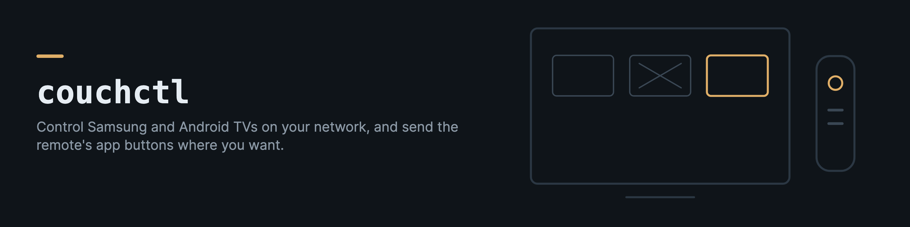

# couchctl

couchctl controls Samsung (Tizen) televisions and Android TV devices on your home network. It reads whether each screen is on, switches it on and off, opens apps, and sends the remote's app buttons to the apps you actually use. It also switches, dims and colors Philips Hue lights through their bridge.

Most remotes have buttons for apps you may never open (Prime Video, Disney+, a local streaming service). These buttons cannot be remapped on the device. couchctl watches which app is in front, and when a button opens one of those apps it opens your chosen app on top.

## Install

```bash
pip install couchctl
```

Android TV devices also need `adb` (`brew install android-platform-tools` on macOS, `apt install adb` on Debian and Ubuntu).

## Configure

couchctl reads `~/.config/couchctl/config.toml` (or the file in `$COUCHCTL_CONFIG`, or `--config`). Copy [examples/config.example.toml](examples/config.example.toml) and change the addresses.

```toml
[devices.living-room]
kind = "samsung"
host = "192.168.1.20"
mac = "aa:bb:cc:dd:ee:ff"

[[devices.living-room.redirect]]
from = "3201910019365"
to = "3201606009684"
name = "Prime Video button to Spotify"

[devices.projector]
kind = "androidtv"
adb = "192.168.1.30:5555"
```

Give each television a fixed address in your router, so the config stays correct.

## Use

```bash
couchctl state                    # on, off or unknown, for every device
couchctl pair living-room         # once per Samsung set, then choose Allow on the TV
couchctl off living-room
couchctl on living-room           # wake-on-LAN
couchctl launch living-room 3201606009684
couchctl key living-room KEY_HOME
couchctl text living-room "jazz radio" --enter   # type into the open field, then submit
couchctl keyboard living-room youtube "disco set"  # walk an app's own keyboard to type it
couchctl front living-room        # which redirected app is on screen
couchctl watch                    # redirect the app buttons until stopped
couchctl watch --dry-run          # log presses without launching anything
couchctl sideload living-room app.wgt --sign myprofile   # install or update a sideloaded app
couchctl sideload projector app.apk --package com.example.player
```

## Philips Hue lights

A Hue bridge is a device of kind `hue` with its address:

```toml
[devices.lights]
kind = "hue"
host = "192.168.1.40"
```

```bash
couchctl hue discover                         # find the bridge's address (needs internet)
couchctl pair lights                          # press the bridge's round button, then run this within 30 s
couchctl hue lights lights                    # every light: on or off, brightness, reachable
couchctl hue groups lights                    # rooms and zones
couchctl hue light lights "Desk lamp" --on --brightness 40 --color "#ff8800"
couchctl hue group lights "Living room" --off
couchctl hue scene lights Relax --group "Living room"
```

The bridge gives a key only within about 30 seconds of its link button being pressed, and that press is the permission: nothing can take a key without it. `pair` keeps asking for those 30 seconds, so the button can be pressed before or just after starting it. The key goes in the same token file as the televisions' tokens. Lights, rooms and scenes are found by name or by their id on the bridge, so set them up in the Hue app and use the names you gave them there.

From Python, `couchctl.hue` has `discover`, `config`, `pair` and a `Bridge` with `lights()`, `groups()`, `scenes()`, `set_light()`, `set_group()` and `recall_scene()`. It uses the bridge's local CLIP v2 API over HTTPS. The bridge's certificate is signed by the vendor's own authority, so the connection is encrypted but the certificate is not checked, as most local Hue clients do. Use it on a network you trust.

## Samsung televisions

The set answers HTTP on port 8001 without a password. That is enough to read its state, see which app is in front and open an app. Remote keys (power off, home, volume) use a websocket on port 8002, and newer sets ask for permission the first time. Run `couchctl pair <device>` while the set is on, and choose Allow on the television when it asks. couchctl keeps the token the set returns in `~/.config/couchctl/tokens.json` (readable only by you) and uses it from then on.

`couchctl on` sends a wake-on-LAN packet to the `mac` in the config every 2 seconds until the set answers, for up to 25 seconds, and says whether it came on. The set only answers it when "Power on with mobile" is enabled (Settings, General, Network, Expert settings on most models).

A Samsung app id is the long number in the Samsung app store (3201606009684 is Spotify), or for a sideloaded app the id its package declares. To find the id behind a button, press the button and run `couchctl front <device> <id> <id> ...` with the ids you suspect, or read the list from the set with `sdb shell 0 vd_applist` if you have Tizen Studio.

## Typing into an app that has its own keyboard

Some apps do not use the set's system keyboard. They draw their own grid of letters on screen that you move through with the remote (YouTube and the clients built on its television interface are the common ones, and some others). `couchctl text` cannot reach such a field, because there is no system keyboard for the injected text to fill, and the set reports success all the same. `couchctl keyboard <device> <app> "<words>"` reaches it the only way that works, by walking that grid with the remote's arrow keys and pressing select on each letter.

Each app's keyboard is described by a small map of its grid, the key it highlights when its search opens, and where space sits (which may be a row above the letters or below them). The known ones are built in (`youtube` and `netflix` today), and an unknown app name prints the list. The presses go over the remote websocket on a Samsung set and over adb on an Android television. It works only while that search keyboard is open and its highlight is still on the key the app started it on, so open the app's search and then type, before moving the highlight by hand. `--enter` presses the app's search button at the end, for keyboards whose button position is known.

## Sideloaded apps

`couchctl sideload <device> <file>` installs or updates an app that does not come from the device's own store, and then checks the result against what the device reports. It never takes the installer's own "completed" or "Success" as proof.

- On a Samsung set the file is a `.wgt`. The set needs developer mode with this machine as its Host PC IP, and the package must be signed for the set (see the skill). `--sign <profile>` signs a package from its author again with your Tizen Studio profile first. Afterwards the set must list the app at the package's version. The sdb server that the install starts listens on every network interface, so it is stopped at the end; `--keep-server` leaves it running. A set that has just woken can take ten minutes or more before it starts the install, while it updates its own apps.
- On an Android TV the file is an `.apk`, and `--package` names it. The installed file must match the `.apk` byte for byte.

`sdb` and `tizen` come from Tizen Studio (`tools/sdb` and `tools/ide/bin/tizen`); set `COUCHCTL_SDB` and `COUCHCTL_TIZEN` when they are not on the PATH. From Python, `couchctl.sideload` also offers `latest_release` and `download` for an app published as GitHub release assets, and `newer` to compare versions.

### When the set trusts another address

Developer mode accepts sdb only from the one Host PC IP entered on the set. If this machine still
holds that address on some interface but reaches the network from another, relay through it:

```bash
couchctl relay --from 192.0.2.243 192.0.2.40:26101    # listens on 127.0.0.1:26102 until stopped
sdb connect 127.0.0.1:26102
```

## Android TV

Turn on network debugging in the device's developer options and allow the adb prompt on screen once. Apps are named by their package (`com.spotify.tv.android`), and `couchctl front` prints whatever package is in front. A device in standby usually stops answering adb, so couchctl reconnects by itself when it comes back.

Most Android TV devices cannot be woken over the network. Some projectors only wake from a Bluetooth signal sent by their own remote.

## How the redirect works

The watcher asks each device once a second which app is in front. When an app with a redirect becomes visible, it opens the replacement.

- It acts only when the app appears, so if you go back to that app on purpose it is left alone.
- When the watcher starts, or when a device comes back after being out of reach, the app already on screen is never treated as a press.
- Each device has its own thread, so a television that is off does not slow down the others.

The original app does appear for a second or two before it is replaced, and the redirect works only while the watcher runs on the same network as the screens. A Raspberry Pi is a good host for it. A systemd unit is in [examples/couchctl-watch.service](examples/couchctl-watch.service).

With `--report-url`, every redirect is also posted as JSON (device, from, to, name, outcome, message, time), with an optional bearer token read from the environment variable named by `--report-token-env`.

## Claude Code skill

```bash
couchctl skill            # copies it to ~/.claude/skills/couchctl
```

The skill gives Claude the whole procedure for taking control of a household's screens with couchctl (finding the devices and their app ids, the settings each one needs, pairing, the redirects, running the watcher) and a table of the failures we met with how to check and fix each one.

## Limits

- couchctl must be on the same network as the screens. From another network every device reads as off, so use `couchctl state --maybe-away` on a laptop that moves between networks.
- The Samsung websocket uses the set's own self-signed certificate, so that one connection is not verified.
- Tested on Samsung Tizen televisions from recent years and an XGIMI projector running Android TV.

## Development

```bash
python -m venv .venv && .venv/bin/pip install -e '.[test]'
.venv/bin/pytest
```

The tests use a fake Samsung set and a fake `adb`, so they need no hardware.

## License

MIT
